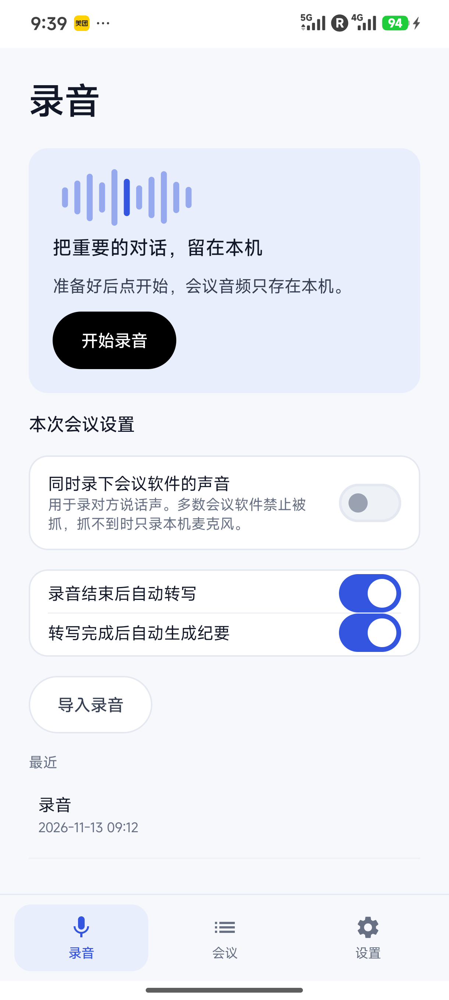
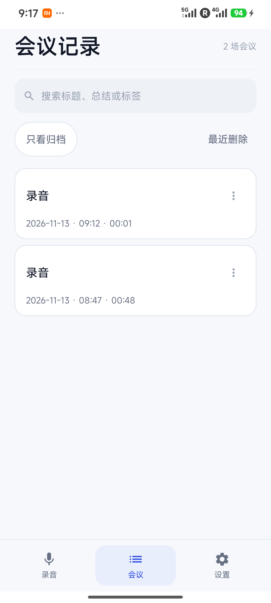
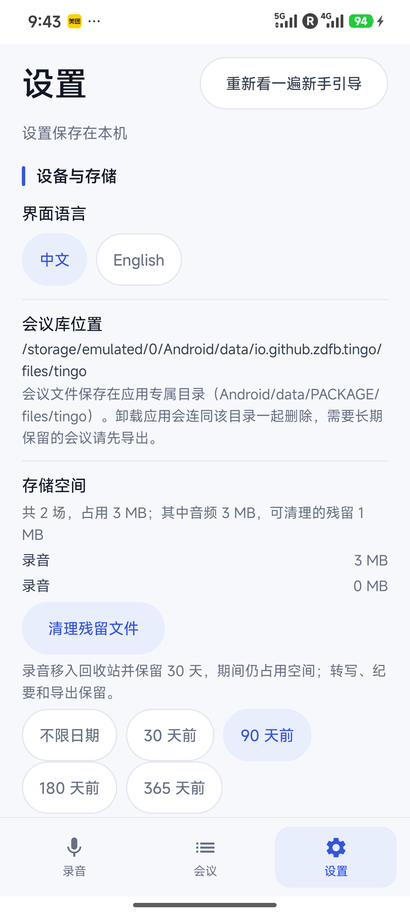

<p align="center"></p>
<h1 align="center">Tingo for Android</h1>
<p align="center">Record meetings, transcribe on your phone, and turn the conversation into minutes.</p>
<p align="center"><a href="https://github.com/zdfb/tingo-android/releases/tag/v0.5.4">v0.5.4 test release</a> · Android 10+ · <a href="README.md">中文</a></p>

## Screenshots

These screenshots show v0.5.4 running on an Android device. The listed meetings are test recordings.

<table><tr><td align="center"><b>Record</b><br></td><td align="center"><b>Meeting library</b><br></td><td align="center"><b>Settings</b><br></td></tr></table>

## Features

- Record microphone audio, optionally attempt to capture audio from other apps, and view live text, provisional speaker labels, and highlights.
- Download Paraformer and its supporting models on first use for on-device transcription and speaker separation.
- Configure your own model service to generate minutes from transcripts, and use timestamps to return to the recording.
- Search, archive, delete and restore meetings; back up data and export meeting content or PDF.

System audio capture requires Android authorization, and some apps prevent capture. Lock-screen recording and dual-source audio synchronization need further device validation.

## Install

1. Download `Tingo-Android-v0.5.4-debug.apk` from the [v0.5.4 release](https://github.com/zdfb/tingo-android/releases/tag/v0.5.4) and install it on Android 10 or later.
2. Confirm the speech model download and grant microphone access. System audio capture requires additional system authorization.
3. To generate minutes, configure a model service URL, model name and API key in Settings.

**Release status:** This test build uses a debug signing key; production signing has not been configured. JVM unit tests and the Debug build passed. Full device automation remains incomplete because the device blocked test activity launches. The new application ID is `io.github.zdfb.tingo` and does not automatically migrate data from older versions.

## Privacy

Recordings and local transcripts are stored in the app's device-specific directory. Generating minutes sends transcript text to the configured model provider; audio files are not sent to that service. Uninstalling the app removes its app-specific files, so back up data first.

## Build

You need JDK 21, Android SDK 37, NDK 30, Rust and `cargo-ndk`. Speech models are downloaded on first use.

```bash
cd app/android
./gradlew :app:assembleDebug
```

See the [Android development guide](app/android/README.md) for build details and historical test results.

## Origin and license

This independent Android project is based on [tancheng33/tingo](https://github.com/tancheng33/tingo). Thanks to the original author and contributors. Licensed under the [MIT License](LICENSE).
