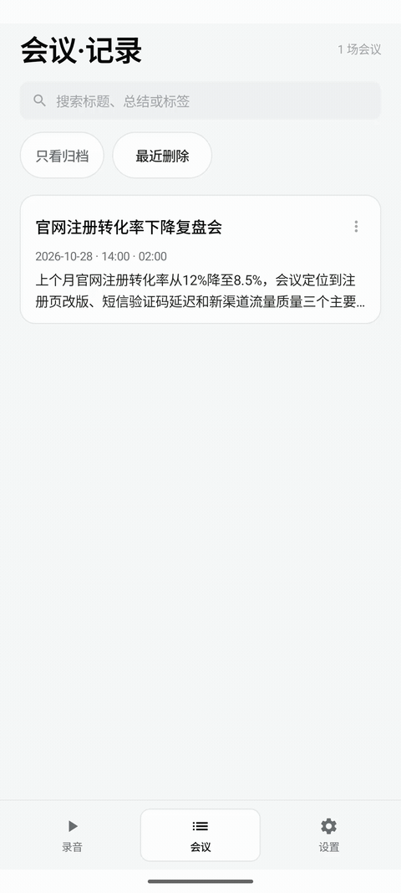
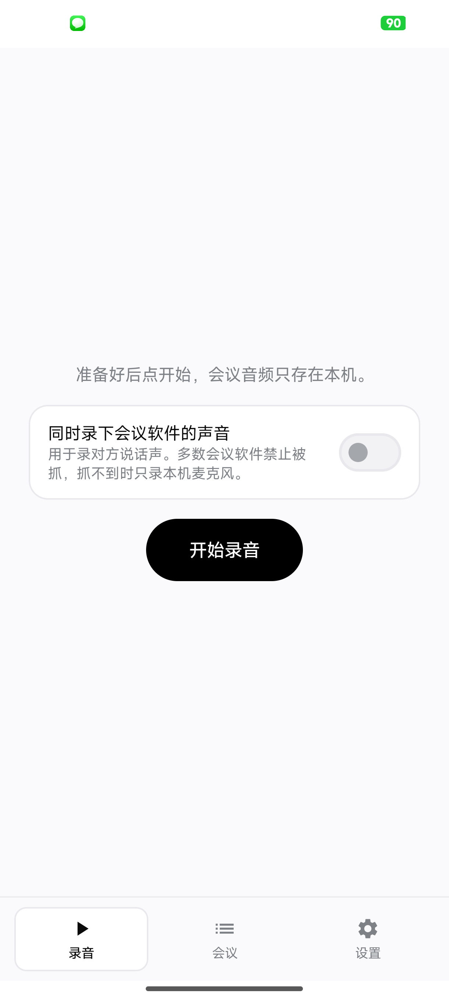
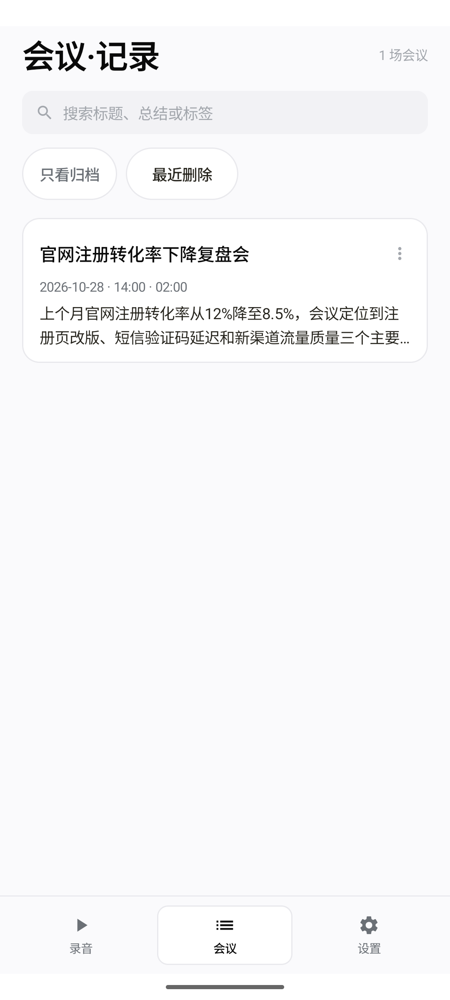
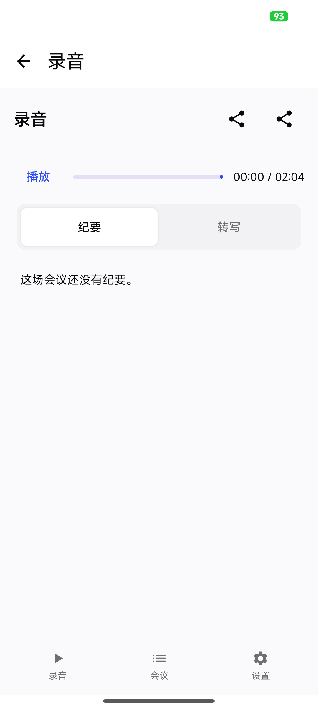
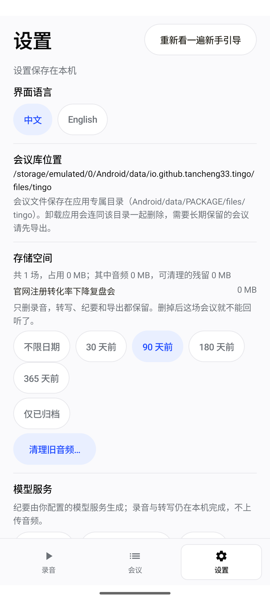

<p align="center"></p>

<h1 align="center">听过 · Tingo for Android</h1>

<p align="center"><b>开过的会，都听过。</b><br>在 Android 手机上录下会议、本地转写，再把每条纪要结论对应回原话。</p>

<p align="center">
  <a href="https://github.com/zdfb/tingo-android/releases/tag/v0.5.2"></a>
  
  
  <a href="README.en.md"></a>
</p>

<p align="center"><a href="docs/android/demo.mp4"></a></p>
<p align="center"><a href="docs/android/demo.mp4">播放 Android 操作录像（MP4，约 34 秒）</a></p>

截图与录屏来自 Android API 36 模拟器上实际运行的 v0.5.2；会议内容是 App 内置的演示会议，不是界面稿或用户录音。GIF 由这段录屏转换而来。

## 项目来源

本项目是基于开源项目 [tancheng33/tingo](https://github.com/tancheng33/tingo) 开发的 Android 版本。感谢原作者及贡献者。本仓库作为独立项目维护，Android 客户端由本项目单独实现。

## Android 界面

<table>
  <tr>
    <td align="center"><b>录音</b><br></td>
    <td align="center"><b>会议库</b><br></td>
  </tr>
  <tr>
    <td align="center"><b>会议详情</b><br></td>
    <td align="center"><b>设置</b><br></td>
  </tr>
</table>

## 功能

- **录音与转写留在手机上**：录麦克风；也可以尝试录会议软件的系统声音。Paraformer 语音识别、标点和说话人区分在本机运行，转写不需要联网。
- **纪要能回到原话**：配置你自己的大模型服务后，用转写文本生成会议纪要；时间戳可以跳回录音对应位置。Tingo 不会把录音上传给纪要服务。
- **管理会议**：搜索会议内容，归档、恢复已删除会议，导出或备份数据；支持中文和英文界面。
- **本地数据可控**：录音和会议文件保存在 Android 应用专属目录。卸载 App 会删除该目录；要长期保留会议，请先从设置中备份或导出。

系统内录使用 Android 的 MediaProjection / Audio Playback Capture，必须在录音时确认系统提示；部分会议应用会禁止捕获对方声音，具体取决于应用和设备。

## 下载与安装

1. 从 [v0.5.2 Releases](https://github.com/zdfb/tingo-android/releases/tag/v0.5.2) 下载 `Tingo-Android-v0.5.2-debug.apk`。
2. 在 Android 提示时，允许当前文件管理器或浏览器安装应用，然后继续安装。
3. 首次录音时授予麦克风权限；要录系统声音时，按提示开启系统录制授权。

该版本面向测试，附件为可直接安装的 debug 构建，安装包约 412 MiB。最低支持 Android 8.0（API 26）。

### 纪要服务与隐私

语音识别和说话人区分在设备上完成。生成纪要时，会议**转写文本**会发送到你在设置中配置的服务商；录音文件不会发送。API Key 保存在应用私有配置中。未配置模型服务时，录音、转写和回听仍可使用。

## 从源码构建

需要 JDK 21、Android SDK 37、NDK 30、Rust 和 `cargo-ndk`。模型随 APK 打包，完整构建产物约 412 MiB。

```bash
cd app/android
./gradlew :app:assembleDebug
```

模型来源与许可证、完整配置和测试说明见 [Android 开发文档](app/android/README.md)。桌面版与 Android 版的功能对照见 [功能对照表](docs/android-parity.md)。

## 许可证

[MIT](LICENSE)
